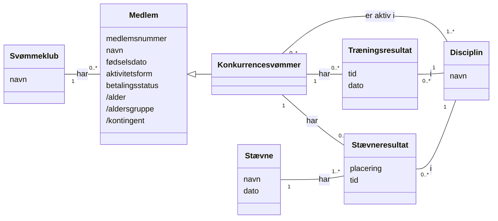

# Domænemodel – Delfinen

Domænemodellen viser begreberne i svømmeklubben og deres sammenhænge, som de fremgår af
user stories US1–US14 ([user-stories.md](user-stories.md)). Den viser **ikke** metoder eller
datatyper. Attributter med `/` foran er **afledte**: de beregnes ud fra andre oplysninger og
indtastes ikke.

## Klasser

| Klasse | Hvorfor den er med | Kilde |
|---|---|---|
| **Svømmeklub** | Klubben, der har medlemmerne. Uden data starter programmet med "en tom klub". | US14 |
| **Medlem** | Formanden opretter medlemmer med navn, fødselsdato og aktivitetsform. Medlemmet får et medlemsnummer og en betalingsstatus. | US1, US3, US7 |
| **Konkurrencesvømmer** | En særlig slags aktivt medlem, der har discipliner og resultater. Det har motionister og passive medlemmer ikke. | US1, US2, US9 |
| **Disciplin** | Fx butterfly og crawl. En konkurrencesvømmer er aktiv i én eller flere. | US2 |
| **Træningsresultat** | En træningstid med dato i en disciplin. | US10 |
| **Stævneresultat** | En placering og tid ved et stævne i en disciplin. | US11 |
| **Stævne** | Stævnet har et navn og en dato, som er fælles for alle resultater fra samme stævne. | US11 |

**Attributter på Medlem:**

- `aktivitetsform` er *aktiv* eller *passiv* (US1).
- Et aktivt medlem er enten **motionist** eller **konkurrencesvømmer**. Konkurrencesvømmeren
  er vist som en specialisering (arv), fordi kun den har discipliner og resultater. Et aktivt
  medlem, der ikke er konkurrencesvømmer, er motionist.
- `betalingsstatus` er *betalt* eller *ikke betalt* for årets kontingent (US7, US8).
- `/alder` beregnes ud fra fødselsdatoen (US4).
- `/aldersgruppe` er *junior* under 18 år og ellers *senior*. Den afgør også, om en
  konkurrencesvømmer er på junior- eller seniorholdet (US4, US9).
- `/kontingent` beregnes ud fra aktivitetsform og alder (US5).

## Relationer og multiplicitet

| Relation | Multiplicitet | Begrundelse |
|---|---|---|
| Svømmeklub – Medlem | 1 – 0..* | Klubben kan være tom (US6, US14). Et medlem hører til én klub. |
| Medlem ◁– Konkurrencesvømmer | arv | En konkurrencesvømmer *er et* medlem. Arv har ingen multiplicitet. |
| Konkurrencesvømmer – Disciplin | 0..* – 1..* | En konkurrencesvømmer skal have mindst én disciplin (US2). En disciplin kan have nul eller mange svømmere. |
| Konkurrencesvømmer – Træningsresultat | 1 – 0..* | En ny svømmer har ingen tider endnu. Hvert resultat tilhører én svømmer (US10). |
| Træningsresultat – Disciplin | 0..* – 1 | Hver tid er registreret i præcis én disciplin (US10). |
| Konkurrencesvømmer – Stævneresultat | 1 – 0..* | Som træningsresultater (US11). |
| Stævneresultat – Disciplin | 0..* – 1 | Hvert stævneresultat er i præcis én disciplin (US11). |
| Stævne – Stævneresultat | 1 – 1..* | Et stævne kommer kun ind i systemet, når et resultat fra det registreres (US11). |

## Bevidst udeladt

- **Formand, kasserer og træner** er *brugere* (aktører) af systemet. Systemet gemmer ingen
  oplysninger om dem, så de er ikke klasser i domænemodellen.
- **Juniorhold og seniorhold** er ikke klasser. Holdet følger direkte af `/aldersgruppe` for
  konkurrencesvømmerne (US9).
- **Restanceliste, top 5 og bedste tid** er ikke klasser. De er udtræk fra data, der allerede
  findes: medlemmer med betalingsstatus *ikke betalt* (US8), og hurtigste
  træningsresultat pr. disciplin (US10, US12, US13).
- **Kontingent som egen klasse** er udeladt. User stories kender kun ét beløb pr. medlem og én
  betalingsstatus for året (US5, US7).
